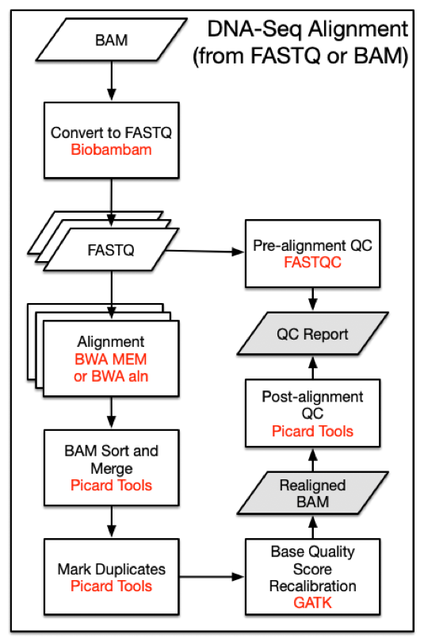

# Data Processing

### Pre-Alignment
Prior to alignment, BAM files that were submitted to the GDC are split by read groups and converted to FASTQ format. Reads that failed the Illumina chastity test are removed. Note that this filtering step is distinct from trimming reads using base quality scores.

### Alignment Workflow
DNA-Seq analysis begins with the [Alignment Workflow](/Data_Dictionary/viewer/#?view=table-definition-view&id=alignment_workflow). Read groups are aligned to the reference genome using one of two [BWA](http://bio-bwa.sourceforge.net) algorithms [[1]](http://www.ncbi.nlm.nih.gov/pubmed/19451168). BWA-MEM is used if mean read length is greater than or equal to 70 bp. Otherwise BWA-aln is used.
Each read group is aligned to the reference genome separately and all read group alignments that belong to a single aliquot are merged using [Picard Tools](http://broadinstitute.github.io/picard) [SortSam](https://broadinstitute.github.io/picard/command-line-overview.html#SortSam) and [MergeSamFiles](https://broadinstitute.github.io/picard/command-line-overview.html#MergeSamFiles). Duplicate reads, which may persist as PCR artifacts, are then flagged to prevent downstream variant call errors.


#### Reference Genome

All alignments are performed using the human reference genome GRCh38.d1.vd1. Decoy viral sequences are included in the reference genome to prevent reads from aligning erroneously and attract reads from viruses known to be present in human samples. Ten types of human viral genomes are included: human cytomegalovirus (CMV), Epstein-Barr virus (EBV), hepatitis B (HBV), hepatitis C (HCV), human immunodeficiency virus (HIV), human herpes virus 8 (HHV-8), human T-lymphotropic virus 1 (HTLV-1), Merkel cell polyomavirus (MCV), Simian vacuolating virus 40 (SV40), and human papillomavirus (HPV). Reference sequences used by the GDC can be downloaded [here](https://gdc.cancer.gov/download-gdc-reference-files).


| I/O | Entity | Format |
|---|---|---|
| Input | [Submitted Unaligned Reads](/Data_Dictionary/viewer/#?view=table-definition-view&id=submitted_unaligned_reads) or [Submitted Aligned Reads](/Data_Dictionary/viewer/#?view=table-definition-view&id=submitted_aligned_reads) | FASTQ or BAM |
| Output | [Aligned Reads](/Data_Dictionary/viewer/#?view=table-definition-view&id=aligned_reads) | BAM |



### DNA-Seq Alignment Command Line Parameters

__Note that version numbers may vary in files downloaded from the GDC Portal due to ongoing pipeline development and improvement.__

#### Step 1: Converting BAMs to FASTQs with Biobambam - biobambam2

=== "Shell"

    ```shell
    bamtofastq \
    collate=1 \
    exclude=QCFAIL,SECONDARY,SUPPLEMENTARY \
    filename= <input.bam> \
    gz=1 \
    inputformat=bam \
    level=5 \
    outputdir= <output_path> \
    outputperreadgroup=1 \
    outputperreadgroupsuffixF=_1.fq.gz \
    outputperreadgroupsuffixF2=_2.fq.gz \
    outputperreadgroupsuffixO=_o1.fq.gz \
    outputperreadgroupsuffixO2=_o2.fq.gz \
    outputperreadgroupsuffixS=_s.fq.gz \
    tryoq=1 \
    ```

#### Step 2: BWA Alignment - bwa - samtools
If mean read length is greater than or equal to 70bp:

=== "Shell"

    ```shell
    bwa mem \
    -t 8 \
    -T 0 \
    -R <read_group> \
    <reference> \
    <fastq_1.fq.gz> \
    <fastq_2.fq.gz> |
    samtools view \
    -Shb
    -o <output.bam> -
    ```

If mean read length is less than 70bp:

=== "Shell"

    ```shell
    bwa aln -t 8 <reference> <fastq_1.fq.gz> > <sai_1.sai> &&
    bwa aln -t 8 <reference> <fastq_2.fq.gz> > <sai_2.sai> &&
    bwa sampe -r <read_group> <reference> <sai_1.sai> <sai_2.sai> <fastq_1.fq.gz> <fastq_2.fq.gz> | samtools view -Shb -o <output.bam> -
    ```

If the quality scores are encoded as Illumina 1.3 or 1.5, use BWA aln with the "-l" flag.  

#### Step 3: BAM Sort - picard 2

=== "Shell"

    ```shell
    java -jar picard.jar SortSam \
    CREATE_INDEX=true \
    INPUT=<input.bam> \
    OUTPUT=<output.bam> \
    SORT_ORDER=coordinate \
    VALIDATION_STRINGENCY=STRICT
    ```

#### Step 4: BAM Merge - picard 2

=== "Shell"

    ```Shell
    java -jar picard.jar MergeSamFiles \
    ASSUME_SORTED=false \
    CREATE_INDEX=true \                 
    [INPUT= <input.bam>]  \
    MERGE_SEQUENCE_DICTIONARIES=false \
    OUTPUT= <output_path> \
    SORT_ORDER=coordinate \
    USE_THREADING=true \
    VALIDATION_STRINGENCY=STRICT
    ```

#### Step 5: Mark Duplicates - picard 2

=== "Shell"

    ```Shell
    java -jar picard.jar MarkDuplicates \
    CREATE_INDEX=true \
    INPUT=<input.bam> \
    VALIDATION_STRINGENCY=STRICT
    ```

### Co-cleaning Workflow

The alignment quality is further improved by the [Co-cleaning workflow](/Data_Dictionary/viewer/#?view=table-definition-view&id=alignment_cocleaning_workflow). Co-cleaning is performed as a separate pipeline as it uses multiple BAM files (i.e. the tumor BAM and normal tissue BAM) associated with the same patient. Both steps of this process are implemented using [GATK](https://software.broadinstitute.org/gatk/).  

#### Indel Local Realignment

Local realignment of insertions and deletions is performed using [IndelRealigner](https://github.com/broadinstitute/gatk-docs/blob/master/gatk3-tooldocs/3.8-0/org_broadinstitute_gatk_tools_walkers_indels_IndelRealigner.json). This step locates regions that contain misalignments across BAM files, which can often be caused by insertion-deletion (indel) mutations with respect to the reference genome. Misalignment of indel mutations, which can often be erroneously scored as substitutions, reduces the accuracy of downstream variant calling steps.

#### Base Quality Score Recalibration

A base quality score recalibration (BQSR) step is then performed using  [BaseRecalibrator](https://gatk.broadinstitute.org/hc/en-us/articles/360036898312-BaseRecalibrator). This step adjusts base quality scores based on detectable and systematic errors. This step also increases the accuracy of downstream variant calling algorithms. Note that the original quality scores are kept in the OQ field of co-cleaned BAM files. These scores should be used if conversion of BAM files to FASTQ format is desired.


| I/O | Entity | Format |
|---|---|---|
| Input | [Aligned Reads](/Data_Dictionary/viewer/#?view=table-definition-view&id=aligned_reads)  | BAM |
| Output | Harmonized Aligned Reads | BAM |

### DNA-Seq Co-Cleaning Command Line Parameters

#### __Step 1:__ RealignTargetCreator

=== "Shell"

    ```Shell
    java -jar GenomeAnalysisTK.jar \
    -T RealignerTargetCreator \
    -R <reference>
    -known <known_indels.vcf>
    [ -I <input.bam> ]
    -o <realign_target.intervals>
    ```

#### __Step 2:__ IndelRealigner

=== "Shell"

    ```Shell
    java -jar GenomeAnalysisTK.jar \
    -T IndelRealigner \
    -R <reference> \
    -known <known_indels.vcf> \
    -targetIntervals <realign_target.intervals> \
    --noOriginalAlignmentTags \
    [ -I <input.bam> ] \
    -nWayOut <output.map>
    ```

#### __Step 3:__ BaseRecalibrator; dbSNP v.144

=== "Shell"

    ```Shell
    java -jar GenomeAnalysisTK.jar \
    -T BaseRecalibrator \
    -R <reference> \
    -I <input.bam> \
    -knownSites <dbsnp.vcf>
    -o <bqsr.grp>
    ```

#### __Step 4:__ PrintReads

=== "Shell"

    ```Shell
    java -jar GenomeAnalysisTK.jar \
    -T PrintReads \
    -R <reference> \
    -I <input.bam> \
    --BQSR <bqsr.grp> \
    -o <output.bam>
    ```

